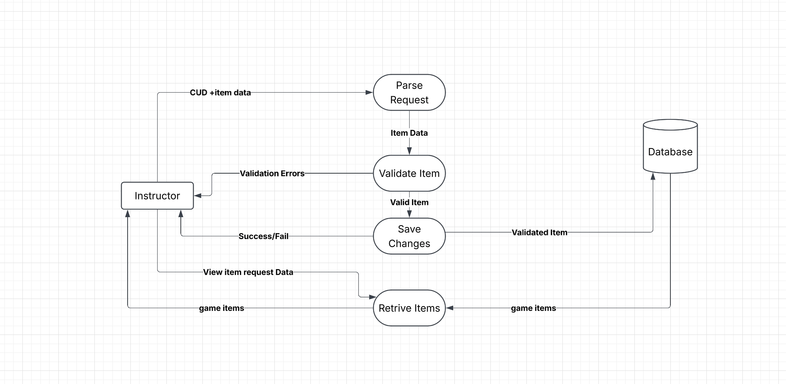

### Game item management DFD level 1

**Purpose:** This component lets an instructor create, update, delete, and view the game items (locations, images, and audio clues) that players use in the game loop.

**Processes**
- 1 Parse request: receives the CUD request and item data from the instructor and passes the item data on for validation.
- 2 Validate item: checks the item data (clue, answer, and image). Invalid items are returned to the instructor as validation errors. Valid items go on to be saved.
- 3 Save changes: performs the create, update, or delete on the game items and returns success or fail to the instructor.
- 4 Retrieve items: takes the instructor's view item request, reads the game items, and returns them to the instructor.

**Data stores**
- Game items: locations, images, and audio clues (written by #3, read by #4).

**Connections:** Game items saved here are read by the game loop when it sets up a game, plays audio clues, and evaluates photos.

**Assumptions:** Every create, update, and delete goes through validation before it is saved. View requests skip parsing and validation and go straight to retrieval.