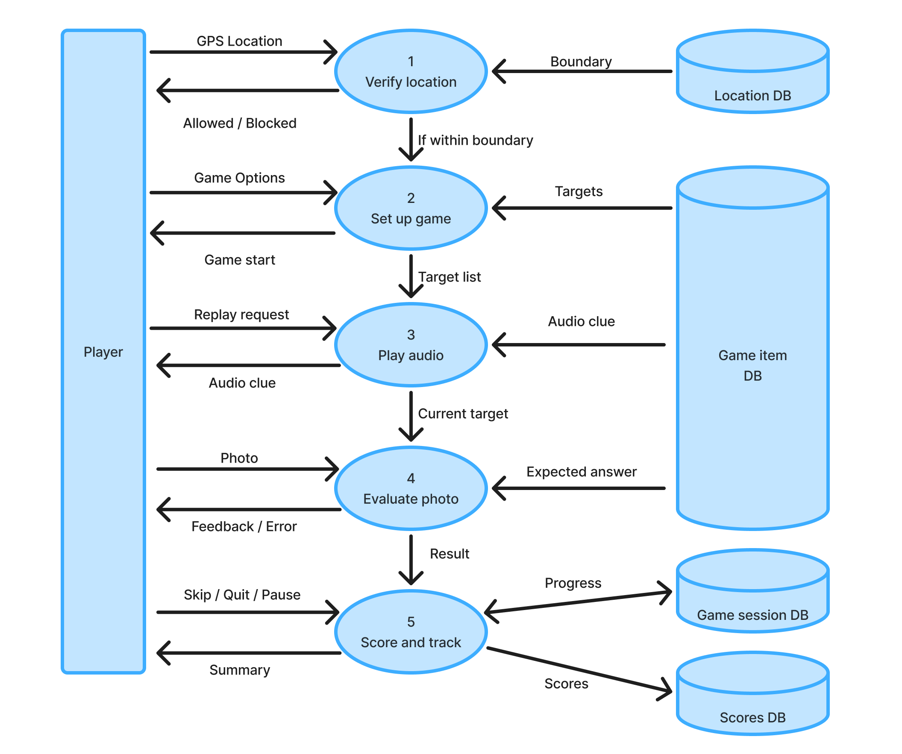

### Game loop DFD level 1

**Purpose:** This component runs a single game session for a player,
from the Play click through to the final score.

**Processes**
- 1 Verify location: checks the player's GPS position against the set boundary when they press Play. Out of boundary players are blocked.
- 2 Set up game: takes the player's settings (language, difficulty, length) and selects targets from the game items.
- 3 Play audio clue: plays and replays the clue for the current target and gives hints.
- 4 Evaluate photo: checks the player's photo against the target and returns correct or retry.
- 5 Score and track: calculates the score for each target, handles skip, pause, and quit, and saves progress.

**Data stores**
- Game items: locations, images, and audio clues (read by 2, 3, 4).
- Game sessions: in-progress state, used for pause and resume.
- Location: the boundary used for the location check.
- Scores: final scores, read by the class and profile components.

**Connections:** Instructor-created items come from Course management. Scores feed the class scoreboard and grade export.

**Assumptions:** Guest scores are not saved. 
