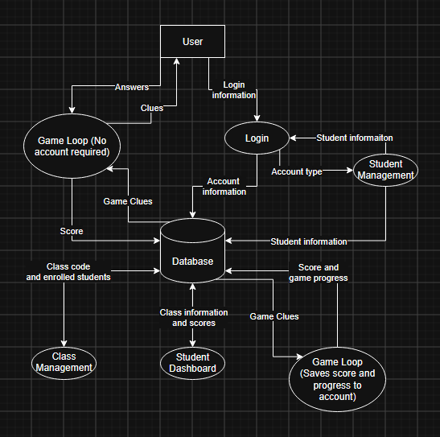

### DFD level 0

**Purpose:** This component overviews the system at a high level.

**Processes**
- Game Loop: Allows a user to play the game without loggin in
- Login: takes login information to let students and instructors access their dashboards.
- Student management: allows instructors to access student information.
- Class Management: shares and stores class codes, and enrolled students.

**Data stores**
- : locations, images, and audio clues (read by 2, 3, 4).