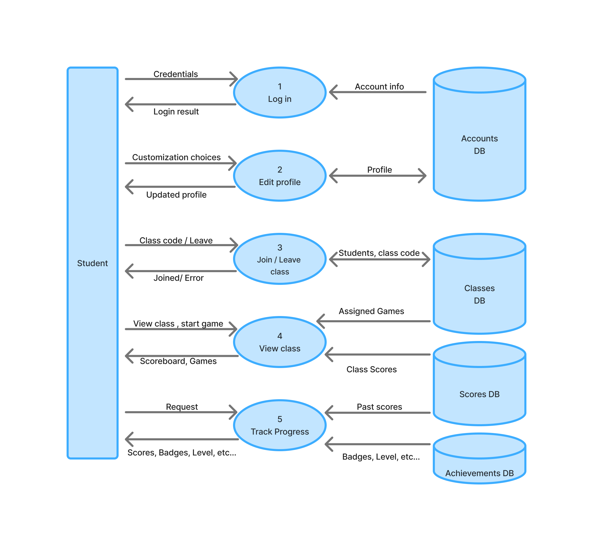

### User view DFD level 1

**Purpose:** This component covers everything a logged-in student does outside of playing a game: logging in, managing their profile, joining
and leaving classes, viewing a class's scoreboard and assigned games, and tracking their own progress and achievements.

**Processes**
- 1 Log in: checks the student's credentials against their account and returns a login result.
- 2 Edit profile: updates the student's avatar and theme settings so they persist across sessions.
- 3 Join/leave class: validates an access code to add the student to a class roster, or removes them from the roster when they leave.
- 4 View class: shows a class's scoreboard (from recorded scores) and its list of assigned games with their settings and due dates. Starting an assigned game continues in the game loop diagram.
- 5 Track progress: shows the student's past scores, checks their results against achievement criteria, awards new badges, and updates their level.

**Data stores**
- Accounts: student credentials and profile settings (read by 1, read and written by 2).
- Classes: classes, access codes, rosters, and assigned games (read and written by 3, read by 4).
- Scores: final scores from completed games (read by 4 and 5). Written by the game loop component.
- Achievements: badges and levels earned (read and written by 5).

**External entities:** Student, who sends credentials, class codes, and requests, and receives results, scoreboards, and progress.

**Connections to other components**
- The game loop (5) writes the scores in scores DB that this component reads.
- Starting an assigned game hands off to the game loop (2), with the settings preset by the instructor instead of chosen by the student.
- Class management (instructor side) creates the classes, access codes, and assignments stored in Classes DB.

**Assumptions and open questions**
- Students can only see the scoreboard for classes they have joined.
- Login is handled by Accounts DB for now. If we integrate with Canvas, it would be added as an external entity.
- Guests have no account, so they do not use this component.
