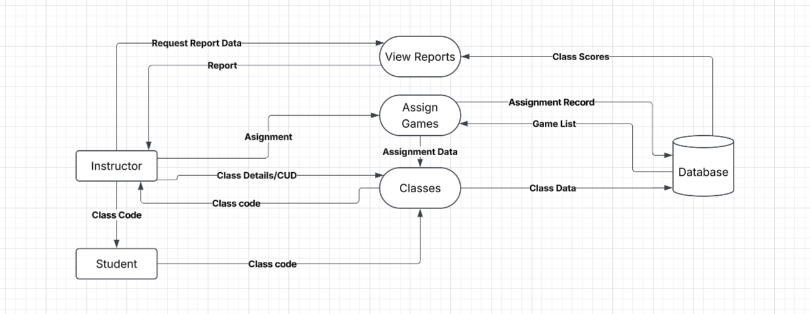

### Class management DFD level 1

**Purpose:** This component lets an instructor create and manage classes, assign games to them, and view class reports. It also lets students join a class using a class code.

**Processes**
- 1 Classes: takes class details and CUD requests from the instructor, creates, updates, or deletes the class, and returns the class code to the instructor. It also receives class codes from students joining a class and receives assignment data from Assign games.
- 2 Assign games: takes an assignment from the instructor, reads the list of available games, saves the assignment record, and passes the assignment data to Classes.
- 3 View reports: takes a report request from the instructor, reads the class scores, and returns the report to the instructor.

**Data stores**
- Classes: class data and assignment records (written by 1, 2).
- Game items: the list of available games (read by 2).
- Scores: class scores (read by 3).

**Connections:** Game items come from Game item management. Scores are written by the game loop. Students join a class here before playing assigned games.

**Assumptions:** The instructor gives the class code to students outside the system (for example, in person or by email). Guest scores are not saved, so reports only include students in a class.