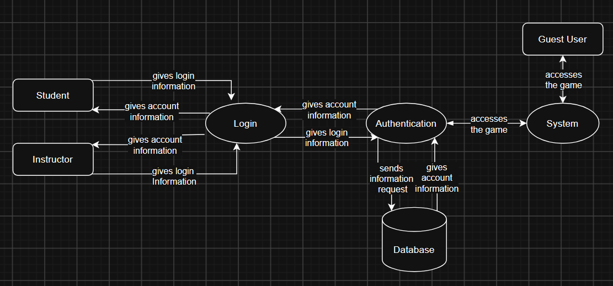

### Login DFD level 1

**Purpose:** This component allows two types of user logins to be
stored in the database, as well as a guest user.

**Processes**
- Login Information: users login information is checked by they system.
- Authentication: users login information is verified by the authentication.
- Retrieve account information: account information is retrieved from the database to return to the user.
- System: the system is given the users account information.

**Data stores**
- Account information: username, password, classes, scores.

**Assumptions:** Guest account information is not saved. 