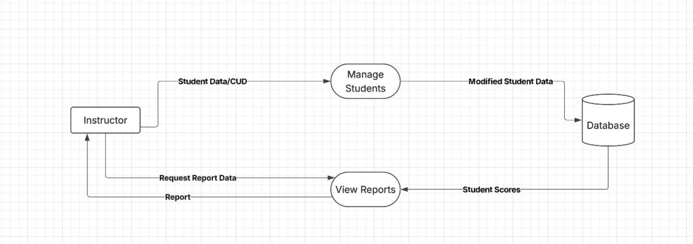

### Student management DFD level 1

**Purpose:** This component lets an instructor update, and delete student accounts and view reports on individual student scores.

**Processes**
- 1 Manage students: takes student data and CUD requests from the instructor and saves the modified student data.
- 2 View reports: takes a report request from the instructor, reads the student scores, and returns the report to the instructor.

**Data stores**
- Users: student account data (written by 1).
- Scores: student scores (read by 2).

**Connections:** Student scores are written by the game loop. Class membership is handled by Class management, and students log in through the login component.

**Assumptions:** Only instructors can create, update, or delete student accounts. Reports cover scores only.