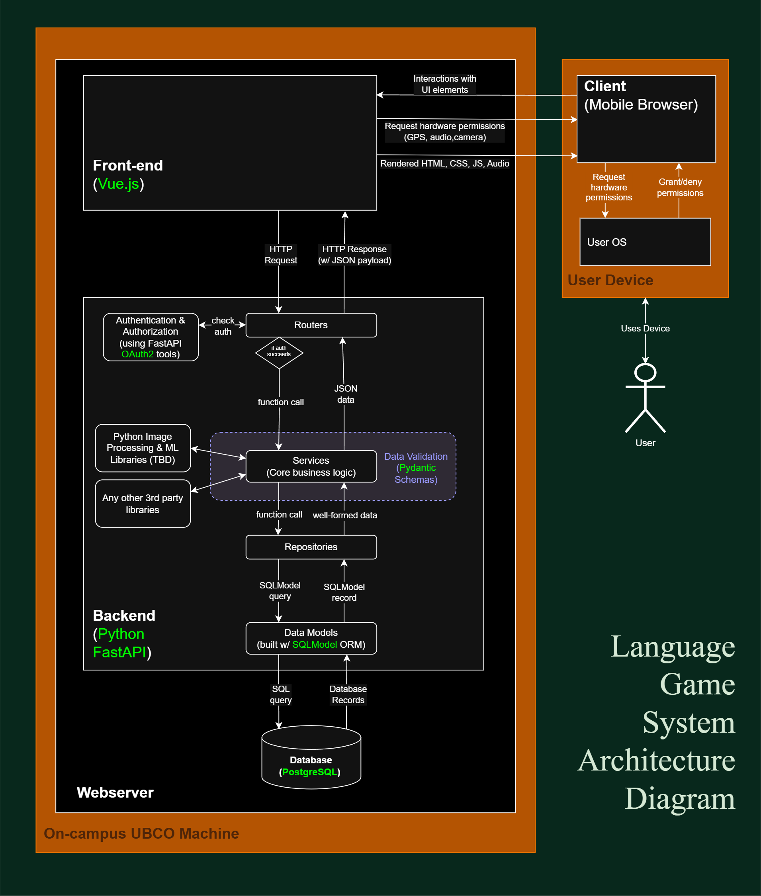

# System Architecture Diagram - text explanation

Our system architecture consists of three major components, all of which will live on a webserver hosted on UBCO's on-premises infrastructure:
1. Vue.js Front-end
2. Python FastAPI Back-end
3. PostgreSQL Database

At this stage in the project, our diagram is focused mainly on the back-end; we are leaving the Vue frontend as a "blackbox" for now since it will be a while before we begin to implement it.

## How the back-end works: layered, data-driven architecture

Within the backend, we are using a layered, data-driven architecture. FastAPI only returns JSON (rather than HTML), so it is concerned only with receiving requests and returing data.

HTTP requests are received by **Routers**. These "route" requests to the right place. 
- First, they call on our **Auth** modules to check whether the request is valid
- Second, they translate request parameters into function parameters and call **Services**

**Services** are the Python files that perform the core "business logic" of the app.
- If a task needs to be delegated a 3rd party library, Services will call it.
- If data must be fetched from the database, Services will call special, readable functions in Repositories

**Repositories** are an abstraction layer that sit above the database. Instead of writing query logic in Services, we encapsulate it in Repositories inside functions that have specialized purposes and are easy to call (along the lines of `get_user_scores_by_course(user, course)`).

Actually, there is another abstraction layer that sits between Repositories and the database: our **Data Models**. These are Python representations of our SQL database tables, which will be built using an Object-Relational Mapping (ORM) tool called SQLModel. This is also where we define things like the database connection logic. SQLModel provides ways for us to safely build database queries in Python, which it translates to full SQL and from there the query _finally_ goes to the database.

Once the **Database** returns data, it goes back up through each of the aforementioned layers:
- first to the Data Model, which makes it available in Python
- then to Repositories, which ensures the data is relevant and well-formed
- then to Services

Notice that "protecting" Services on all sides is a data validation layer, which is defined using Pydantic **Schemas**. This is a core part of FastAPI's design and an advantage it has over other Python microframeworks like Flask: it forces you to give and receive well-formed, typesafe data.

Once Services has received data from Repositories and/or third party libraries and/or any other utility modules, it passes a JSON payload back to the Routers, which send the correct HTTP response back to the front-end.

