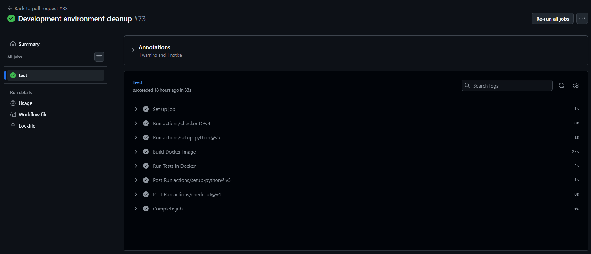

# Individual Log - Week 6

>  [!NOTE] 
> My apologies for submitting my log 1hr late. I was reviewing my teammates PRs to make sure they were submitted on time `:)`

## For PR [#88 Development environment cleanup](https://github.com/COSC-499-W2026/capstone-project-team-9/pull/88)

> associated issues:
> - [#47 Clean up Dev Environment Setup](https://github.com/COSC-499-W2026/capstone-project-team-9/issues/47)

### What I did

As part of our internal requirement to maintain a consistent development and testing environment between different team members, the development team needs to be able to run and test code inside a Docker container.

Therefore, I implemented code and docs that consolidate and improve the environment setup work of the last few weeks by making Docker, FastAPI, unit tests, CI, and pyproject.toml all work together. This PR enforces the use of a Docker container to run the app and the test suite, and documents that a venv should just be used for keeping your code editor happy. In particular:

- `pyproject.toml` now enforces minimum version numbers for both Python and dependencies (this is best practice)
- The Docker container now works with `pyproject.toml` (was previously broken as it was set up for `requirements.txt`)
- Tests can now be run inside the container, which ensures that we are developing and testing in the exact same enviroment
- Our CI workflow also run tests inside a Docker container built from the same image
- The app and tests _cannot_ be run from a venv, or anywhere outside the docker container, because of new `docker_guard.py` utility functions
- The `README.md` now documents the new, unified local development workflow, which is basically: Run app in Docker, run tests in Docker, use a venv only so your IDE knows what tooltips to give you.

### Verification and problem-solving

When I reviewed the updated `Dockerfile`, I noticed that the build didn't work because Python couldn't resolve dependencies properly without the `src/` folder. Therefore, I added a line to install `src/` before trying to resolve dependencies.

When I reviewed a generated version of what later became `_docker_guard()`, I noticed that it was printing warnings in the console twice, because it was inside a `pytest_` prefixed function in `conftest.py`. Therefore, I moved it outside the function and switched to a `sys.exit` rather than a `pytest.exit`, and ultimately moved the logic to another file entirely.

When I reviewed the updated testing and app-running flow for this functionality, I did not find any problems with it because I built the docker container, ran the app and tests inside the docker container, all without having a venv.

Once I did add a venv again, I verified that the `docker_guard` worked by trying the `fastapi` and `pytest` commands from the venv, and seeing that they failed. I also wrote unit tests to verify this programmatically, in `tests/test_utils/test_docker_guard.py`.

When I reviewed the CI workflow, I noticed that tests were failing when I made a draft PR, because they were running outside of Docker. Therefore, I updated `.github/workflow/test.yml` to use our Docker image instead of setting up its own environment.

### Engineering Practices

The PR does not contain any temporary workaround because it sets up the Docker container in a way that will enforce environment parity between developers and CI, and which is very similar to the containerized environment that the app will actually run in once deployed.

The PR only contains small functions that are 1-8 lines long (excluding docstrings).

 I added `_docker_guard()` as a single function that gets reused by two thin wrapper functions, `ensure_app_running_in_docker()` and `ensure_tests_running_in_docker()`, which are then called cleanly in `main.py` and `conftest.py` respectively, in order to ensure that my feature contribution does not contain any of the following:
 - hardcoded values
 - duplicate code
 - dead code
 - unnecessary function calls
 - excessive conditional logic
 - deep nesting
 - high cyclomatic complexity
 - classes/modules/functions with many unrelated responsibilities  

### Reviews

The reviews by Joe and Eric did not identify any problems.

### Architecture impacts

The `docker_guard` work is written in `src/utils/docker_guard.py` because it is utility code that imposes a simple restriction on the app's environment, rather than providing regular functionality. It is inside `src/utils` rather than just `utils/` because it is part of the Python backend.

Tests now run in the Docker container in order to ensure that our code passes tests in the same environment that it runs in.

This work does not belong in any data flow diagrams, because it is related to the development setup rather than user functionality.

### Testing Receipts

The functionality works correctly because the happy path tests involving `test_docker_guard_passes_inside` passed.

I checked that these negative cases involving `test_docker_guard_exits_outside` and they failed as expected.

Among these tests, both are unit tests, and integration tests are not required because the function being tested is modular, its functionality is very simple, and it does not impact users at all (it only exists to encourage good dev behaviour).

These tests are included in the directory `tests/test_utils/test_docker_guard.py`.

This PR does not break anything else in the system because our regression tests workflow passed before merge.

---

## For PR [#122 Postgres Setup](https://github.com/COSC-499-W2026/capstone-project-team-9/pull/122)

### What I Did

As part of our requirement to store user and game data persistently, our system needs a database.

Therefore, I implemented/generated `docker-compose` code to add a third Docker service (i.e. container) called `db`, which is built from the official Postgres Docker image.
Our database will run inside of this container.

### Verification and Problem-solving

When I reviewed the generated code for spinning up a container for this functionality, I did not find any problems with it because I verified that the database defined in `schema.sql` was actually live by entering a live Postgres session, listing all tables, inspecting the tables, and running some basic SQL statements like `INSERT` and `SELECT`. The specific commands to run are documented in both the `README` and the PR description so that reviewers could use the same verification process. 

### Engineering Practices

 The PR does not contain any temporary workaround because it adheres to our overall longterm solution of containerizing our major services. 
 The PR only contains no traditional functions; it's all config code.
 I used environment variables to prevent hardcoded credential values, ensuring that my feature contribution does not contain any of the following:
 - hardcoded values
 - duplicate code
 - dead code
 - unnecessary function calls
 - excessive conditional logic
 - deep nesting
 - high cyclomatic complexity
 - classes/modules/functions with many unrelated responsibilities

### Reviews

The reviews by Nash and Eric did not identified any problems.

### Architecture Impacts

This work is written in `docker-compose.yml` because that file orchestrates our different Docker services and allows us to spin up all three containers (one for `db`, one for `backend`, and one for `frontend`) with a single terminal command (`docker compose up`). No `Dockerfile` is needed in this case because the container is built from the official `Postgres` image. Also, this container mounts a "data volume" so that data is persistent even when the container has stopped (of course if the database needs to be reset locally, that is easy to do - and is documented in the README). 

### Testing Receipts

Not really applicable, except for the fact that nothing existing broke and regression testing still passed.

### Data Receipts

The database credentials may be vulnerable to being stolen and misused if they are committed to Git (even if they are just dev credentials for now, you never know what credentials are accidentally used in production). Therefore, I moved any secret or changeable environment variables to a `.env` file, and created a `.env.example` for my teammates to use as a template for their own `.env` files. This keeps credentials out of code, even config code like `docker-compose`, and ensures that secrets like db passwords are never made public.

---

## For PR [#123 Delete temp/campus_boundary.geojson](https://github.com/COSC-499-W2026/capstone-project-team-9/pull/123)

> mini-PR, doesn't require template

Deleted the temporary file `temp/campus_boundary.geojson`, an unused file that was accidentally left lying around in the repo after my review of PR [#57](https://github.com/COSC-499-W2026/capstone-project-team-9/pull/57) last week.

---

## For PR [#128 Update .gitignore to include build/](https://github.com/COSC-499-W2026/capstone-project-team-9/pull/128)

> mini-PR, doesn't require template

Added `build/` to our `.gitignore`. It's a build directory that is sometimes generated by the project when you re-setup a `.venv`, and shouldn't be committed to version control.

---

## Other non-PR things I did this week

- Did most of [#46 Move Requirements into Project Board](https://github.com/COSC-499-W2026/capstone-project-team-9/issues/46) and created new `PARENT` and `req` labels and parent issues, to help us organize, plan and properly prioritize our work. 
  - See: [issues I'm the author of](https://github.com/COSC-499-W2026/capstone-project-team-9/issues?q=is%3Aissue+state%3Aopen+author%3Aiansteyn), [project board table view](https://github.com/orgs/COSC-499-W2026/projects/2/views/3)
- Created more major and upcoming milestones
  - see: [reupo milestones](https://github.com/COSC-499-W2026/capstone-project-team-9/milestones), [project board milestone view](https://github.com/orgs/COSC-499-W2026/projects/2/views/6)
- Updated meeting minutes 
  - see [docs/minutes/meeting-minutes.md](https://github.com/COSC-499-W2026/capstone-project-team-9/blob/main/docs/minutes/meeting-minutes.md)
- Thoroughly reviewed PRs
  - see [#113](https://github.com/COSC-499-W2026/capstone-project-team-9/pull/113), [#124](https://github.com/COSC-499-W2026/capstone-project-team-9/pull/124), [#121](https://github.com/COSC-499-W2026/capstone-project-team-9/pull/121) 

---
