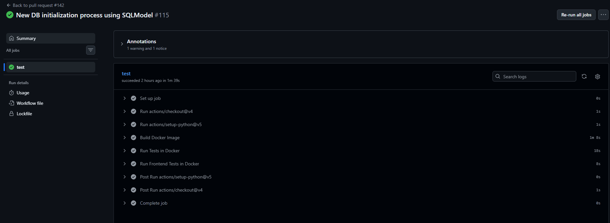
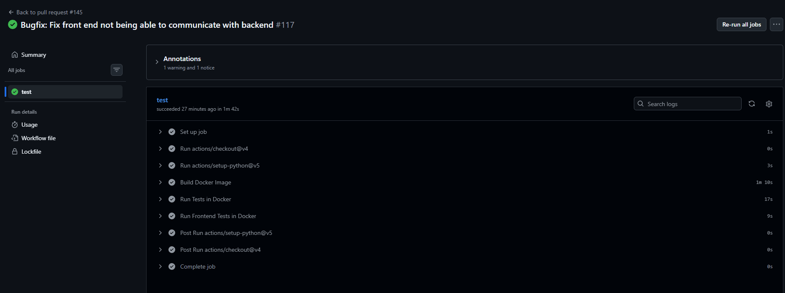
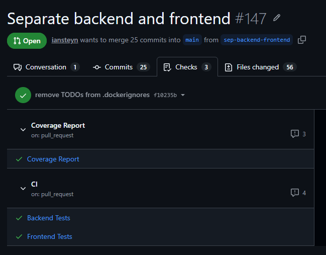

# Individual Log - Week 7

>[!NOTE]
> Most of this log was merged before 12 AM, I just realized I forgot to fill out a few fields and came back to do that. Sorry! The focus was, once again, on merging functional code on time first `:)`

## For PR [#142 New DB initialization process using SQLModel](https://github.com/COSC-499-W2026/capstone-project-team-9/pull/142)

> associated issues:
> - [#139 Research SQLModel and Dependency Injection](https://github.com/COSC-499-W2026/capstone-project-team-9/issues/139)
> - [#10 Setup Data Models](https://github.com/COSC-499-W2026/capstone-project-team-9/issues/10)

### What I did

As part of our requirement to store game and user data, we need a way to connect to our database. And in order to iteratively improve that database and work with it in development, we need a consistent way to define its tables without our data models drifting over time.

Therefore, I implemented Python code that defines one SQLModel table, connects to the database, and initializes the database with that table. This PR lays the groundwork for implementing more data models, setting up the dependency injection pattern, and adding more database scripts (like a seeding script).

### Verification and Problem-solving

When I reviewed our existing `schema.sql` approach to initializing the database, I realized that we would have to maintain both `schema.sql` and our SQLModels in `models/`, which is prone to drift and is asking for needlessly difficult debugging later on. Therefore, I disconnected `schema.sql` from automatically initializing the database, opting to instead define tables purely in SQLModel and initialize the database with a Python script.

When I attempted to connect to DB the using the new `DATABASE_URL`, I noticed that the connection failed because something called `pscyopg` was not installed. I learned that this is a Python package that SQLModel (or more accurately, the underlying SQLAlchemy) needs in order to communicate with Postgres. It is not installed by default with SQLModel. Therefore, I added it to our project dependencies, using the `[binary]` variant of `psycopg3` because it is the most efficient and up to date option.

When I reviewed the `init_db()` function for initializing the database, I realized that it was not creating any tables despite not throwing an error. This was because SQLModel was not able to register the models. Therefore, I made sure the `models` module exposed all table models inside its `__init__.py`, which allows SQLModel to register them when the `models` module is imported. I also added unit tests for model registration, so that this error will be automatically caught as more models are added.

### Engineering Practices

The PR does not contain any temporary workaround because:
- I did not add any logic for getting the database session, because that work is not ready yet and initializing the database does not require a session
- `scripts/init_db.py` is fully functional, as far as I know nothing needs to be added to it; we just need to continue defining more data models
- The new `core/` folder follows our value of good organization, and will hold other app-wide infrastructure that everything else relies on to run (such as the session dependency)
- The SQLModel table `Language` is based directly on the one defined in `schema.sql`, so the data has the same shape as before
- `schema.sql` was disconnected but is being kept as a design reference, so that the other models can be added in future PRs

The PR only contains small functions that are 1-2 lines long (and tests that are 1-5 lines long).

I did the following...
- encapsulated database connection logic and anything that uses the SQLModel `engine` in `core/db.py`
- after some deliberation, opted to keep `schemas/` and `models/` as separate modules, because they have different repsonsibilities (one defines the shape of data that crosses the API boundary, the other defines the shape of data in the database)
- encoded the `DATABASE_URL` as an environment variable built from the `POSTGRES_USER`, `POSTGRES_PASSWORD` and `POSTGRES_DB` environment variables

... To ensure that my feature contribution does not contain any of the following:
```
 - hardcoded values
 - duplicate code
 - dead code
 - unnecessary function calls
 - excessive conditional logic
 - deep nesting
 - high cyclomatic complexity
 - classes/modules/functions with many unrelated responsibilities
 ```

### Reviews

The reviews by Joe and Nash did not identify any problems.

### Architecture Impacts

- The logic for initializing the database is written in `init_db()` in `src/core/db.py` to ensure that any logic regarding connecting to the database or using SQLModel `engine` is encapsulated in one place.
- The actual _script_ for initializing the database is written in `scripts/init_db.py`, so it can be run using the command line, and so that it is clear it is intended to be run manually (as a script) rather than part of the main application functionality.
- The `Language` table is defined in `models/language_model.py`, in the same module where all models defining tables will live, in accordance with our layered architecture pattern. This is a separate folder from `schemas/`, which is where we will define the shape of data that crosses the API boundary.

This work does not belong in a particular DFD, since it is more about the logic of how the data stores in the DFDs actually work under the hood.

### Testing Receipts

The functionality works correctly because the happy path tests `test_all_table_models_are_registered()` and `test_every_model_file_is_imported_in_models_init()` passed. 

When I reviewed `test_every_model_file_is_imported_in_models_init()`, I noticed that it would count commented out lines as valid imports, which is problematic because the test could pass while model registration still fails. Therefore, when reading the `models/__init__.py` file, I made sure to ignore commented out lines. 

Among these tests, all are unit tests and integration tests are not required because all that needs to be checked is that tables are properly created. Infrastructure for database integration tests may be added soon, once there is more complex database logic.

These tests are included in the directory `test/test_models/test_model_registration.py`.

This PR does not break anything else in the system because our regression tests workflow passed before merge.  


---

## For PR [#145 Bugfix: Fix front end not being able to communicate with backend](https://github.com/COSC-499-W2026/capstone-project-team-9/pull/145)

### What I did + Verification and Problem-solving

This is a very small PR that fixes a bug where the front-end was unable to communicate with the back-end because requests to the API where not able to go outside of the front-end container. Clicking on "check backend" resulted in a 500 error.

I diagnosed the problem by reading frontend and backend logs: frontend logs said it was a Vite proxy issue, and the backend logs showed that requests never reached the backend.

To fix it, I changed the `BACKEND_URL` environment variable (which is where Vite forwards API requests) from `http://localhost:8000` to `http://backend:8000`. This allows the frontend container to properly make requests to the backend container. Now, clicking on "check backend" returns an `OK` again, as it should.

### Engineering Practices

The PR does not contain any temporary workaround because the Vite proxy target is set by an environment variable _only_, which means this fix applies regardless of the host machine.

The PR does not contain any new functions.

I removed the default Vite proxy target so that there would be a single source of truth for the `BACKEND_URL` thus ensuring that my feature contribution does not contain any of the following:
```
 - hardcoded values
 - duplicate code
 - dead code
 - unnecessary function calls
 - excessive conditional logic
 - deep nesting
 - high cyclomatic complexity
 - classes/modules/functions with many unrelated responsibilities
```

### Reviews

The reviews by Joe and Nash did not identify any problems.

### Architecture Impacts

Note that I removed `BACKEND_URL` from `.env.example`; it is now only defined in `docker-compose.yml`. I did this because it doesn't depend on the individual developer/host, rather it depends on docker-compose config information and will be the same for everyone.

This work does not really belong in a DFD, as it is a simple bugfix to infrastructure.

### Testing Receipts

This PR does not require unit tests.

This PR does not break anything else in the system because our regression tests workflow passed before merge.


---

## For PR [#143 Move docker guard into core/](https://github.com/COSC-499-W2026/capstone-project-team-9/pull/143)

> Mini PR, template does not apply

This PR applies a very small organizational change in anticipation of further upcoming improvements to the repo organization. I moved `docker_guard.py` out of `utils/` and into `core/`. It fits better there, since it is an infrastructure/core setup tool.

I did this as a separate PR because it could be done independently without breaking anything else.

---

## For PR [#147 Separate backend and frontend](https://github.com/COSC-499-W2026/capstone-project-team-9/pull/147)

> Associated Issues:
> - [#119 Directory restructure to separate frontend and backend](https://github.com/COSC-499-W2026/capstone-project-team-9/issues/119)
> - [#149 Separate backend and frontend CI workflow](https://github.com/COSC-499-W2026/capstone-project-team-9/issues/149)

### What I did

As part of our requirement for the user to interact with our system via a mobile web interface, our system needs a frontend that is separate from our backend. At this stage in the project, only a very basic version of our frontend is needed, and was already set up last week. However, elements of our frontend and backend were entangled together in an unclean way.

Therefore, in an effort to keep our project maintainable, scalable, and upholding SRP, I reorganized our codebase in a way that cleanly separates the frontend and backend, and implemented configuration code to keep our workflows the same with the new organization. In particular, I:

1. Changed the directory structure
   - all tests, including frontend tests, are now in `tests/` (as per Bowen's instructions)
   - all code functionality is now in `app/` (as per Bowen's instructions)
     - however, the backend and frontend have been separated and each encapsulate their config and core `src/` files
   - In the backend, `scripts/` has been moved out of `src/` to make it clearer that they are not part of the core application
2. Changed config
3. Changed CI

### Verification and Problem-solving

When I reviewed the backend tests after relocating them, I did not find any problems because I updated the test paths in `pyproject.toml` and `docker-compose.yaml` and verified that the tests still worked by running them in a fresh container.

When I moved the `Dockerfile` into `app/backend/`, the backend Docker image was no longer able to build properly. Therefore, I updated the build context and volume mountings in `docker-compose.yaml`.

When I moved `scripts/` from `backend/src/` to `backend/`, the `init_db.py` script was no longer runnable inside the backend container. Therefore I updated the `Dockerfile` to ensure `scripts/` are still copied into the backend container, then verified that it worked by running `init_db.py` on a fresh db instance.

When I attempted to run frontend tests after relocating them, they didn't work, even after I adjusted the test paths in `vite.config.js`. This was because the tests were using relative paths to import frontend modules, which were not able to resolve properly in the container. Therefore I added an alias `@` to `vite.config.js`, which tests can use to safely import frontend modules from anywhere.

### Engineering Practices

The PR does not contain any temporary workaround and adheres to long term solution because...
- No terminal commands were changed except for what you need to run to install dependencies in your local `venv`
- it separates backend and frontend tests as well
- it adheres to instructions given by course instructors
- it is, at its core, about preparing the repo for long-term growth

The PR does not contain any new functions.

I did the following...
- added environment variable `FRONTEND_URL` to backend image
- applied separation of concerns as described throughout this receipt 

...to ensure that my feature contribution does not contain any of the following:
```
 - hardcoded values
 - duplicate code
 - dead code
 - unnecessary function calls
 - excessive conditional logic
 - deep nesting
 - high cyclomatic complexity
 - classes/modules/functions with many unrelated responsibilities
 ```

### Reviews

The reviews by Eric and Joe did not identify any problems.

### Architecture Impacts

> Old directory structure
> ```
> .
> ├── src/
> │   ├── <fastAPI modules>
> │   ├── scripts/
> │   └── frontend/
> │       ├── src/
> │       ├── tests/
> │       └── <frontend config stuff>
> ├── tests/
> │   └── <only backend tests>
> ├── <backend config stuff>
> └── docker-compose.yml
> ```
> 
> New directory structure
> ```
> .
> ├── app/
> │   ├── backend/
> │   │   ├── src/
> │   │   │   └── <fastAPI modules>
> │   │   ├── scripts/
> │   │   └── <backend config stuff>
> │   └── frontend/
> │       ├── src/
> │       └── <frontend config stuff>
> ├── tests/
> │   ├── backend/
> │   └── frontend/
> └── docker-compose.yaml
> ```

> Key
> - `<fastAPI modules>` is folders like `models/`, `schemas/`, `routes/` etc
> - `<backend config stuff>` is files like the backend `Dockerfile`, `pyproject.toml`, etc
> - `<frontend config stuff>` is files like `package.json`, `vite.config.js`, etc

Config work is written in relevant config files for reasons explained above in "Verification and Problem-Solving".


### Testing Receipts

This PR does not add any new unit tests.

This PR does not break anything else in the system because our regression tests workflow (now split into a frontend and backend job) passed before merge.  


---

## For PR [#158 Scripts for DB seeding](https://github.com/COSC-499-W2026/capstone-project-team-9/pull/158)

### What I did

As part of several requirements, we need to store user and game data, and to develop many of our features it is helpful to have seed data in our development database so we can locally work with and test our functionality.

Therefore, I implemented/generated code for the following scripts:
- `seed_reference.py`
- `seed_dev.py`
- `reset_db.py`


### Verification and Problem-solving

When I reviewed the `seed_reference.py` and `seed_dev.py` scripts for this functionality, I noticed that they threw ugly errors if they were run before `init_db.py`. Therefore, I added an internal helper in `seed_helpers.py` to check if the table being added exists yet, which exits the calling program with a reminder to use `init_db.py` first.

When I reviewed each of the scripts for this functionality further, I did not find any problems with them because I verified that each one worked by running them on a fresh docker container and then inspecting the database.

### Engineering Practices

The PR does not contain any temporary workaround because these are robust, easy-to-use scripts built to be reused week-to-week. This makes for much smoother development long-term than the previous option, which was to write your own one-off script or insert data using SQL in an interactive pgsql session. I documented the commands to run the scripts: in the scripts themselves and in the README.

The PR only contains small functions that are 1-15 lines long (including docstrings and empty lines).

I did the following...
- added environment variable `ENV` to prevent destructive database actions from happening outside the dev environment
- put logic re-used by both seeding scripts into functions in `seed_helpers.py`
- built `reset_db.py` script by reusing functions from the other scripts
- added a new function `drop_db()` to mirror `init_db()`
- Put seed data into list[dictionary] variables rather than putting each row in its own `session.add()` statement

...to ensure that my feature contribution does not contain any of the following:
```
 - hardcoded values
 - duplicate code
 - dead code
 - unnecessary function calls
 - excessive conditional logic
 - deep nesting
 - high cyclomatic complexity
 - classes/modules/functions with many unrelated responsibilities
 ```

### Reviews

The reviews by Joe and Eric did not identify any problems.

### Architecture Impacts

This work is written mostly in the `app/backend/scripts/` directory because these are development tools rather than code that makes the app run. However these scripts are very important to our ability to continuing feature development in the coming weeks.

`drop_db()` is written in `app/backend/src/core/db.py`, because core database operation functions that depend on model registration live there.

This work does not belong in a DFD.

---

## Other non-PR things I did this week

- Project management 
  - See: [issues I'm the author of](https://github.com/COSC-499-W2026/capstone-project-team-9/issues?q=is%3Aissue+state%3Aopen+author%3Aiansteyn), [project board table view](https://github.com/orgs/COSC-499-W2026/projects/2/views/3)
- Updated meeting minutes 
  - see [docs/minutes/meeting-minutes.md](https://github.com/COSC-499-W2026/capstone-project-team-9/blob/main/docs/minutes/meeting-minutes.md)
- Thoroughly reviewed PRs
  - [#133](https://github.com/COSC-499-W2026/capstone-project-team-9/pull/133), [#140](https://github.com/COSC-499-W2026/capstone-project-team-9/pull/140), [#150](https://github.com/COSC-499-W2026/capstone-project-team-9/pull/150), [#151](https://github.com/COSC-499-W2026/capstone-project-team-9/pull/151), [#152](https://github.com/COSC-499-W2026/capstone-project-team-9/pull/152)
- Fixed issues with Eric's commit history in PR [#150](https://github.com/COSC-499-W2026/capstone-project-team-9/pull/150)