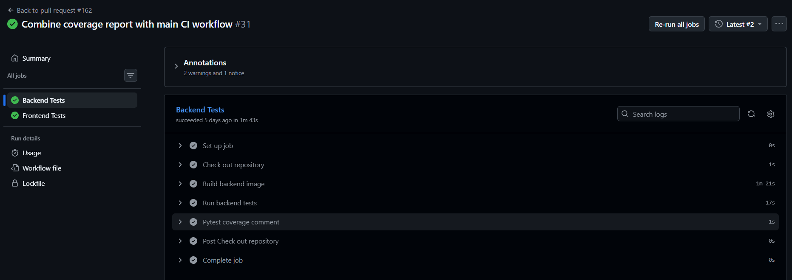
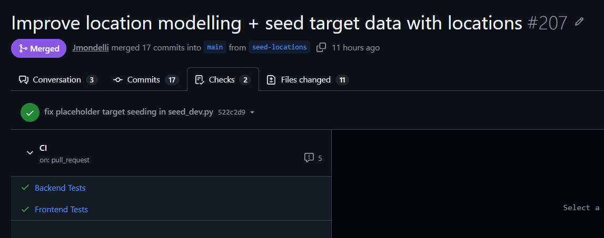
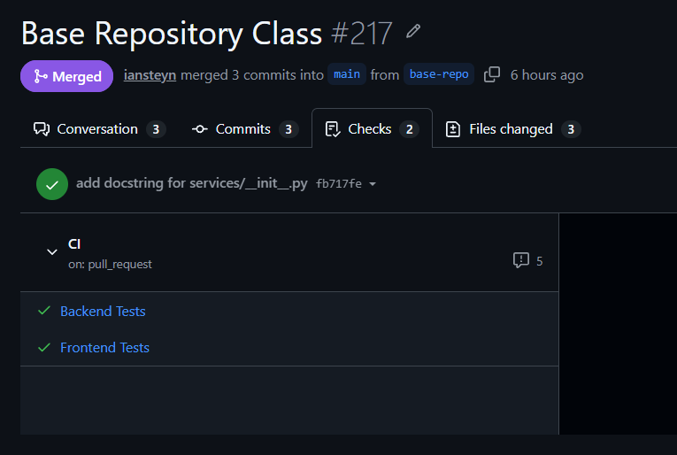
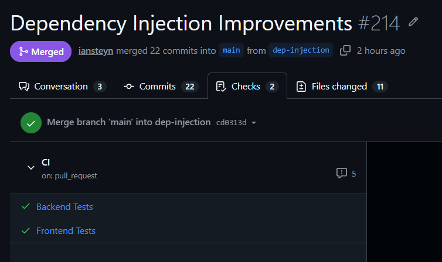
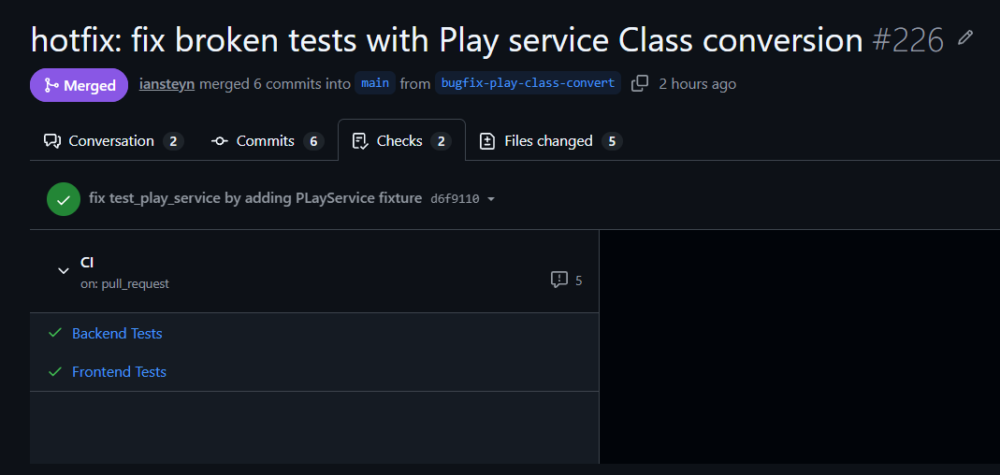

# Individual Log - Week 8
_Ian Steyn_

> [!NOTE]
> Sorry, I know this log is slightly late; I decided to do it well rather than not at all. Please forgive me! We had some unforeseen last-minute issues this week (see PR #226 below) that kept me from completing my logs earlier.

## For PR [#161 Cleanup db and test folders](https://github.com/COSC-499-W2026/capstone-project-team-9/pull/161)

> Mini-PR: template does not apply

Just some helpful file organization cleanup:
- grouped backend tests into folders that mirror the structure of the backend
  - e.g. all repo tests go in `test_repos/`
- Got rid of the `db/` folder and moved its contents into `docs/` and `tests/`
  - we no longer needed a dedicated db folder outside of `app/` and it was cluttering up our root

---

## For PR [#162 Combine coverage report with main CI workflow](https://github.com/COSC-499-W2026/capstone-project-team-9/pull/162)

> Mini-PR: template does not apply

> Associated issues: [#136 Combine coverage and main tests into a single workflow](https://github.com/COSC-499-W2026/capstone-project-team-9/issues/136)

Our backend tests were running twice for every push to a PR branch or `main`, which made our CI take longer than neccessary and cluttered up our checks logs. Therefore I:
- deleted `cov.yaml`
- moved coverage stuff into the "Backend Tests" job of `ci.yaml` so that backend tests only have to run once

The new regression tests look even cleaner, and passed before merge:  


---

## For PR [#207 Improve location modelling + seed target data with locations](https://github.com/COSC-499-W2026/capstone-project-team-9/pull/207):

> associated issues:
> - [#172 seed location data](https://github.com/COSC-499-W2026/capstone-project-team-9/issues/172)

### What I did

As part of the requirement to check a user's location when they start a game or submit an answer, the user needs to be able to pass a latitude and longitude to the backend, and have that point checked against an allowed area.

We already have services that do this, our modelling for this was unclear and tangled. Therefore, I implemented the following code:
- Added new base models called `LocationPoint` and `LocationArea`
- `LocationCheckRequest` schema now inherits from `LocationPoint` instead of `BaseModel`
- `Target` model now inherits from `LocationArea` instead of `SQLModel` and no longer has an `image` field
- Removed `TargetLocation` dataclass from `location_service.py`

I also added seed data for locations to our seeding scripts, so we can test location-related stuff with our development database.

### Verification and Problem-solving

When I reviewed the `Target`, `LocationCheckRequest` and `TargetLocation` definitions, I noticed latitude and longitude (and their validation) were defined separately in each, which risks them drifting apart. Therefore, I created shared `LocationPoint` and `LocationArea` models in `location_model.py`, made `Target` and `LocationCheckRequest` inherit from them, and removed `TargetLocation`.

When I ran the tests after changing `Target`, I noticed the `add_clues` factory, the `seed_dev.py` placeholders and `test_all_table_models_are_registered` broke: the first two used the old fields, and the registration test expected a table in every model file. Therefore, I updated them to the new fields and exempted `location_model.py` from the registration test, since it has no table.

When I reviewed how the new required columns affect existing data, I noticed old dev databases are incompatible with the new `Target`. Therefore, I told reviewers in the PR description to reset their database with `reset_db.py`.

When I reviewed the effort this change took, I noticed a small model change forced edits across many files and layers and broke unrelated tests, so our layers are more tightly coupled than intended. Therefore, I recorded it in the PR description as a note for the team. It is addressed by the dependency injection work in #214 (see below).

When I reviewed the location logic and seed data, I did not find any problems with them because:
- the distance check is unchanged apart from renaming `radius_m` to `radius`, and the existing location tests pass against `LocationArea`
- `LocationPoint` keeps the previous latitude and longitude bounds
- I took the three target coordinates (COM 201, SCI 128, ART 366) directly from Google Maps
- both reviewers ran the app from a reset database and confirmed it works, and CI passed

### Engineering Practices

The PR does not contain any temporary workaround because:
- I used real UBCO building coordinates for seeding data
- I properly documented all new models and modules using docstrings
- I removed a previous model that was erroneously defined inside a service class

The PR contains no new functions, only new data models.

I did the following:
- made location data models with identical fields inherit from shared base classes

... to ensure that my feature contribution does not contain any of the following:
```
 - hardcoded values
 - duplicate code
 - dead code
 - unnecessary function calls
 - excessive conditional logic
 - deep nesting
 - high cyclomatic complexity
 - classes/modules/functions with many unrelated responsibilities
 ```

### Reviews

The reviews by Joe and Eric identified no problems.

### Architecture Impacts

The new location base models are written in `models/location_model.py` because they are data definition objects that are extended by the `Target` model as well as some schemas.

### Data Receipts

`LocationPoint` is modeled as a pair of floating point numbers `latitude` and `longitude` because it represents a simple geographic location. We considered alternative models such as using a specialized data type like a `geoalchemy2` `Geography` point - however we are not dealing with large distances, and we want to test whether simple floating point is precise enough for the use-case, so that we don't need to add yet another dependency. If not, we'll switch.

`Latitude` and `longitude` use validation to ensure they are within real-world latitude and longitude values. `radius` uses validation to ensure it is a possible real-world radius, i.e. larger than 0. 


### Testing Receipts

This PR does not break anything else in the system because all regression tests passed before merge.  


---

## For PR [#217 Base Repository Class](https://github.com/COSC-499-W2026/capstone-project-team-9/pull/217)

### What I did

In anticipation of refactoring our backend to use cleaner dependency injection (see #214 below), I implemented a base class for repositories called `BaseRepository`, which takes a database `session` in its constructor. I also added docstrings for the `repositories` and `services` packages to document each of their purposes more clearly.

### Verification and Problem-solving

When I reviewed the constructor suggested by Claude for this functionality, I did not find any problems with it because it uses the simple, well-established Python pattern for class constructors, and adheres my requirement for repositories to depend on a database session.

### Engineering Practices

The PR does not contain any temporary workaround because:
- it makes progress towards the upcoming refactor without breaking or modifying any existing structures
- it contains good documentation that looks ahead to future long-term solution of exposing classes in the __init__.py files of the `services` and `repositories` packages

The PR only contains small functions that are 1 line long.

I did the following:
- defined a base repository class so that I won't have to repeat the same constructor across all repos

...to ensure that my feature contribution does not contain any of the following:
```
 - hardcoded values
 - duplicate code
 - dead code
 - unnecessary function calls
 - excessive conditional logic
 - deep nesting
 - high cyclomatic complexity
 - classes/modules/functions with many unrelated responsibilities
 ```

### Reviews

The reviews by Eric and Nash identified no problems.

### Architecture Impacts

This work is written in `repositories/base_repo.py` because that is where all repositories go, as a part of our layered architecture design.

This work does not belong in a DFD, as it defines a base class for actual repositories.

### Testing Receipts

This PR contains no new tests because the `BaseRepository` is extremely simply in its actual implementation (the main work here was thinking through the design choices and understanding the purposes of different layers).

This PR does not break anything else in the system because all regression tests passed before merge.  


---

## For PR [#214 Dependency Injection Improvements](https://github.com/COSC-499-W2026/capstone-project-team-9/pull/214)

> associated issues: #180

### What I did

As part of our requirement to build a backend that stays modular and unit-testable as the codebase grows, each layer (router, service, repository) needs to depend only on the layer directly below it, with its dependencies injected rather than passed down by hand. Until now, the `session` was injected into almost every router and then handed through every service to the repos. That works, but it can't support proper unit testing or a clean separation of layers, and it gets harder to fix with every feature we add.

Therefore, I introduced a clean dependency injection pattern and applied it across the router, service and repository layers of the "create a custom game" flow (`GET /languages`, `/difficulties`, `/game-lengths`, `POST /games`). `ClueRepository`, `GameService` and `GameOptionsService` are now classes, their dependencies are declared in `core/dependencies.py`, and FastAPI injects them into the routers. Player-facing behaviour is unchanged. This PR is the reference implementation for next week, when all remaining services and repos are converted the same way.

### Verification and Problem-solving

When I reviewed the moved methods in `clue_repo.py`, `game_service.py` and `game_options_service.py`, I did not find any problems with them because the logic is unchanged. Each method only switched from taking `session` as a parameter to using `self.session` / `self.clue_repo`, and the existing tests, which cover validation, clue counting and game creation, pass against the new classes. I also ran the app locally to make sure all module imports properly resolved and the backend could be built successfully.

When I reviewed the existing tests for this functionality, I noticed they all called the old module-level functions (e.g. `create_game(session, ...)`), so they broke as soon as the code moved into classes. Therefore, I added `clue_repo`, `game_options_service` and `game_service` fixtures and updated the calls to use them, keeping every expected value the same so the tests still check the same behaviour.

### Engineering Practices

The PR contains two known, intentional partial workarounds. `GameService` and `GameOptionsService` still take `session` directly, because they use functions from repos that haven't been converted to classes yet. The tests also import `ClueRepository` instead of mocking it. Both are marked with TODOs. I left them to avoid one huge PR, and both are planned for next week's conversion. Everything else in the PR is the intended long-term design: constructor-injected dependencies declared in one place, which is the exact pattern the remaining services and repos will be converted to.

The PR only contains small functions. The longest is `GameService.create_game` at 21 lines including docstring and blank lines, and every other function is 11 lines or fewer.

I did the following:
- using `Annotated` `...Dep` aliases (`SessionDep`, `ClueRepositoryDep`, `GameServiceDep`, ...) to avoid repeating long `= Depends()` expressions
- defining all wiring in `core/dependencies.py`
- using classes with instance variables for the session and repos, instead of passing `session` through every call

... to ensure that my feature contribution does not contain any of the following:
```
 - hardcoded values
 - duplicate code
 - dead code
 - unnecessary function calls
 - excessive conditional logic
 - deep nesting
 - high cyclomatic complexity
 - classes/modules/functions with many unrelated responsibilities
```

### Reviews

The reviews by Eric and Nash identified no problems. Eric ran the app and confirmed it still works, and Nash noted it should make future test code cleaner.

### Architecture Impacts

Classes are written in their existing files (`ClueRepository` in `clue_repo.py`, `GameService` in `game_service.py`, `GameOptionsService` in `game_options_service.py`) because they already own that responsibility, so moving them would only add import and git-history churn.

Classes are exposed at the package level in `__init__.py`, following Python convention, to make them easier to import.

Dependencies are defined in one place, `core/dependencies.py`, so that routers only declare what they need, wiring changes happen in one file, and tests can swap implementations via FastAPI's `dependency_overrides`.

This work is written in a new file, `core/dependencies.py`, because it wires together repositories, services and the DB session, so it doesn't belong to any single layer.

This work does not belong in a DFD because it concerns the practical implementation of how data is transferred between layers of the backend rather than the conceptual design of data flow in the system.

### Testing Receipts

I didn't add new tests. I updated three existing test files (`test_clue_repo.py`, `test_game_options_service.py`, `test_game_service.py`) to use the new classes instead of module-level functions.

The functionality works correctly because the existing happy-path tests, such as `test_create_game_saves_and_returns_the_game`, `test_returns_the_requested_number_of_distinct_ids` and `test_max_equals_clue_count_when_fewer_than_cap`, still pass. The existing abnormal-case tests, such as `test_create_game_rejects_unavailable_options`, `test_create_game_rejects_when_not_enough_clues_and_saves_nothing`, `test_no_clues_returns_zero_range` and `test_returns_empty_list_when_no_clues_match`, also still pass.

regression tests passed before merge:


After merge it conflicted with parallel play code on main, which was fixed in #226. 

---

## For PR [#226 hotfix: fix broken tests with Play service Class conversion](https://github.com/COSC-499-W2026/capstone-project-team-9/pull/226)

> associated issues: #180

### What I did

This was a hotfix: after #214 merged, the backend tests on `main` failed because the play code, developed in parallel, still called the old module-level clue functions that #214 had converted into class methods.

As part of our requirement to keep `main` stable and passing its automated tests, the team needs players to still be able to start a play of a game (random clues matching the game's ruleset, saved in order) after the dependency injection refactor in #214.

Therefore, I converted the play service into a `PlayService` class, added `PlayServiceDep` to `core/dependencies.py`, and made `play_router.py` depend on it. Starting a play works again for players, and the play code now follows the same injection pattern as the rest of the backend.

### Verification and Problem-solving

When I investigated why backend tests were failing on `main` after #214 merged, I noticed the play code still imported the old module-level `get_random_clue_ids` from `clue_repo.py`, which #214 had turned into a `ClueRepository` method. Therefore, I applied the #214 pattern to the play code across all layers. `PlayService` now receives a `ClueRepository` through its constructor and calls `self.clue_repo.get_random_clue_ids(...)`, and I added a `play_service` fixture to `test_play_service.py`. I confirmed the fix by running the backend tests locally.

### Engineering Practices

The PR contains one known temporary workaround, the same as in #214. `PlayService` still takes `session` directly, because it uses `get_game` and `add_play_with_clues` from repos that haven't been converted to classes yet. Everything else is the intended long-term design: the same constructor-injected pattern the rest of the backend is moving to.

The PR only contains small functions. The longest is `PlayService.start_play` at 16 lines including docstring, and the rest are 15 lines or fewer.

I did the following:
- reused the exact structure established in #214 (`PlayServiceDep` alias, wiring only in `core/dependencies.py`, `session` and repo stored as instance variables), so the play code is consistent with the rest of the backend
- kept the fix focused: 5 files, with the existing tests keeping their expected values unchanged
- aligned `get_game_service` with the `SessionDep` / `ClueRepositoryDep` aliases, so all wiring in `dependencies.py` now uses the same short form

... to ensure that my contribution is small and consistent, and does not contain any of the following:
```
 - hardcoded values
 - duplicate code
 - dead code
 - unnecessary function calls
 - excessive conditional logic
 - deep nesting
 - high cyclomatic complexity
 - classes/modules/functions with many unrelated responsibilities
```

### Reviews

The review by Nash identified no problems.

### Architecture Impacts

This work is written in the existing files (`play_service.py`, `play_router.py`, `services/__init__.py`, `core/dependencies.py`) because the play logic already lives there, and `PlayServiceDep` joins the other dependencies in the single wiring file.

This work does not belong in a DFD because it concerns the practical implementation of how data is transferred between layers of the backend rather than the conceptual design of data flow in the system.

### Testing Receipts

I didn't add new tests. I updated the 9 existing tests in `test_play_service.py` to use a new `play_service` fixture. The happy-path tests (`test_start_play_saves_play_for_the_game`, `test_start_play_returns_the_requested_number_of_distinct_clues`, `test_start_play_saves_the_clues_in_the_returned_order`) pass, and so do the abnormal-case tests (`test_start_play_raises_when_game_does_not_exist_and_saves_nothing`, `test_start_play_raises_when_not_enough_clues_and_saves_nothing`).

#214 broke the backend tests on `main` because the play code still called the old module-level clue function, which #214 turned into a class method. Therefore, I converted the play service to use the injected `ClueRepository`. Now, I can confirm that regression tests pass again.  


---

## Other Things I did this week

- finally finished issue [#46 Move Requirements in Project Board](https://github.com/COSC-499-W2026/capstone-project-team-9/issues/46)
- thoroughly reviewed PRs: [#210](https://github.com/COSC-499-W2026/capstone-project-team-9/pull/210), [#213](https://github.com/COSC-499-W2026/capstone-project-team-9/pull/213), [#216](https://github.com/COSC-499-W2026/capstone-project-team-9/pull/216), [#215](https://github.com/COSC-499-W2026/capstone-project-team-9/pull/215), [#221](https://github.com/COSC-499-W2026/capstone-project-team-9/pull/221), [#222](https://github.com/COSC-499-W2026/capstone-project-team-9/pull/222), [#223](https://github.com/COSC-499-W2026/capstone-project-team-9/pull/223)

