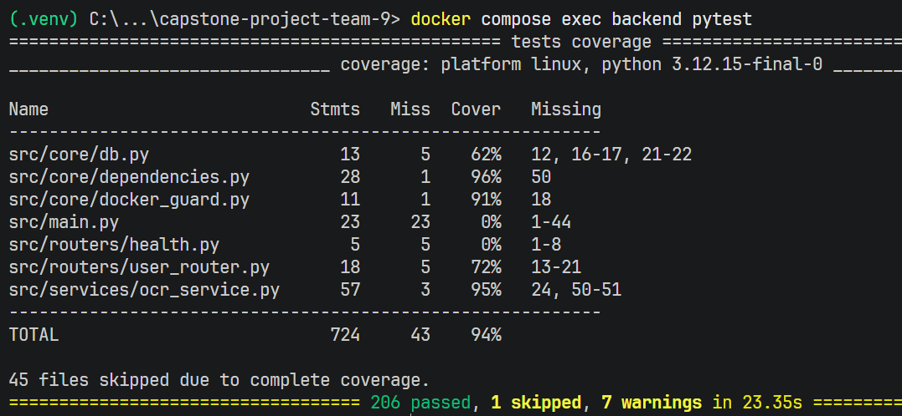
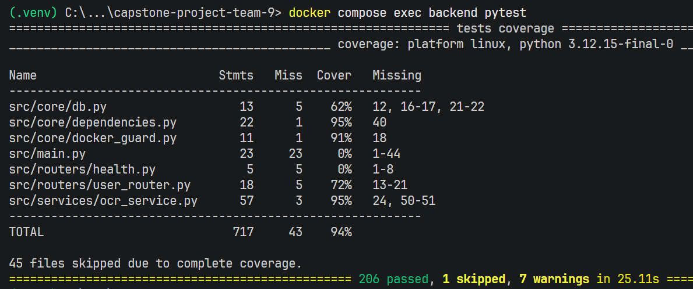
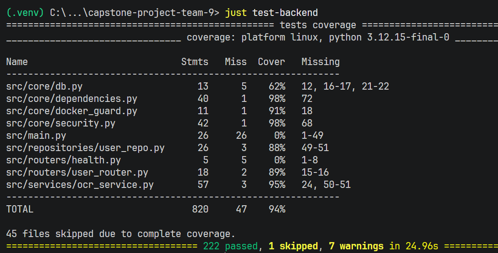

# Week 9 Individual Log
_Ian Steyn_

## For PR [#241 GameRepository & GameOptionsRepository classes](https://github.com/COSC-499-W2026/capstone-project-team-9/pull/241)

> associated issues: 
> - part of [#240 Convert All Repositories to Classes](https://github.com/COSC-499-W2026/capstone-project-team-9/issues/240) (which is itself part of the [#180 dependency injection](https://github.com/COSC-499-W2026/capstone-project-team-9/issues/180) refactor project),

### What I did

As part of our requirement to create a maintainable codebase that can continue to evolve for the rest of our capstone (and be handed off to future teams at the end of it), as well as our requirement to test our code thoroughly and reliably, I am refactoring our codebase so that all repositories and services are classes that use Dependency Injection pattern.

Therefore, in this PR, I implemented code to convert two repositories into classes: `GameRepository` and `GameOptionsRepository`, and injected them as dependencies into all services that use their methods: `GameOptionsService`, `GameService`, and `PlayService`.

### Verification and Problem-solving

When I searched for every caller of the old module-level `get_game`, `add_game`, `get_language` and `get_difficulty` functions, I noticed `PlayService` also called `get_game` directly, so it would have broken once `game_repo.py` became a class. Therefore, I injected `GameRepository` into `PlayService` as well.

When I ran the tests after converting the repositories, I noticed the repo tests and the service fixtures still used the old functions and constructors, so they broke. Therefore, I added `game_repo` and `game_options_repo` fixtures, and updated the service fixtures to build the services with the new repositories. All expected values are unchanged, so the tests still check the same behaviour.

When I reviewed the moved methods in `game_repo.py` and `game_options_repo.py`, I did not find any problems with them because:
- the logic is unchanged: each method only switched from a `session` parameter to `self.session`
- the existing repo and service tests pass with the same expected values
- I ran the app locally and checked the endpoints still respond the same

### Engineering Practices

This PR contains only one known temporary workaround that relates to testing; it is discussed below in Testing Receipts. Otherwise, it moves the codebase closer toward our longterm maintainable solution of defining everything neatly as classes! I am intentionally converting these modules to classes in discrete chunks, so that as little as possible of the codebase is made unavailable to teammates at any given time.

The PR only contains small functions that are 1-3 lines long (there are no new functions except for 3 small pytest fixtures; the short service class constructors were modified sligthtly).

I did the following...
- extended both new repository classes from the existing `BaseRepository` to allow `session` to be used as an instance variable (without having to redeclare identical constructors)
- updated wiring in `core/dependencies.py`, using `Annotated ...Dep` aliases (`GameRepositoryDep` and `GameOptionsRepositoryDep`) to avoid repeating long `= Depends()` expressions
- Ensured that `GameService` and `GameOptionsService` no longer depend directly on `Session` at all, meaning we have clean separation of concerns between layers for those files.
  - (Note: `PlayService` still depends on it, because `play_repository.py` has not yet been converted to a class - followed up in #254)
- defined reusable fixtures `game_repo` and `game_options_repo` for testing purposes

... to ensure that my feature contribution does not contain any of the following:
```
 - hardcoded values
 - duplicate code
 - dead code
 - unnecessary function calls
 - excessive conditional logic
 - deep nesting
 - high cyclomatic complexity
 - classes/modules/functions with many unrelated responsibilities
 ```

### Reviews

The reviews by Joe and Eric identified no problems.

### Architecture Impacts

`GameRepository` and `GameOptionsRepository` are written in their existing files (`game_repo.py` and `game_options_repo.py`) because they already own that responsibility, so moving them would only add import and git-history churn.

These classes are exposed at the package level in `repositories/__init__.py`, following Python convention, to make them easier to import.

Dependencies are still defined in one place, `core/dependencies.py`, so that wiring changes happen in one file, and tests can swap implementations via FastAPI's `dependency_overrides`.

As a small portion of a refactor project, this work does not belong in a DFD.

### Testing Receipts

I updated existing tests in the following files, so that all existing tests would pass with the new structure:
- `test_game_options_repo.py`
- `test_game_repo.py`
- `test_game_options_service.py`
- `test_game_service.py`
- `test_play_service.py`

The repo methods are still covered by the existing happy-path tests (e.g. `test_add_game_saves_and_assigns_id`, `test_get_all_languages_returns_them_sorted_by_name`) and edge-case tests (e.g. `test_get_game_found_and_missing`, `test_get_all_languages_empty_table`).

The one testing workaround: the service test fixtures build `GameOptionsService`, `GameService` and `PlayService` with real repositories instead of mocks. Each has a `TODO in future: MOCK these repositories` comment in `test_game_options_service.py`, `test_game_service.py` and `test_play_service.py`. Proper mocking depends on a wider review of how our tests use the database, so it's left for a later PR. I made an issue for this, see [#243](https://github.com/COSC-499-W2026/capstone-project-team-9/issues/243)

Although our CI workflow is currently down, I can confirm this PR did not break anything else in the system because I ran all tests in a fresh Docker container on my machine. My reviewers did the same.  


---

## For PR [#237 LocationService Class](https://github.com/COSC-499-W2026/capstone-project-team-9/pull/237)

> associated issues: 
> - part of [#239 Convert All Services to Classes](https://github.com/COSC-499-W2026/capstone-project-team-9/issues/239) (which is itself part of the [#180 dependency injection](https://github.com/COSC-499-W2026/capstone-project-team-9/issues/180) refactor project)
> - closes [#209 Combine test_target_location_service and test_location_service](https://github.com/COSC-499-W2026/capstone-project-team-9/issues/209)


### What I did

As part of our requirement to create a maintainable codebase that can continue to evolve for the rest of our capstone (and be handed off to future teams at the end of it), as well as our requirement to test our code thoroughly and reliably, I am refactoring our codebase so that all repositories and services are classes that use Dependency Injection pattern.

Therefore, in this PR, I implemented code to convert the location service into a class `LocationService`, defined it as a dependency in `core/dependencies.py`, and updated the location router and answer service to depend on it.

### Verification and Problem-solving

When I tried to run the app after importing `LocationService` into `answer_service.py`, I noticed that the backend refused to build because dependencies were not resolving correctly. This was because `PlayService` imports the answer service which imports `LocationService`, but `LocationService` was imported _after_ `PlayService` in the package's `__init__.py`. Therefore, I reordered the `services/__init__.py` import statements and added a note on ordering for future reference.

When reviewing the `location_service.py` file, I noticed that the simple `verify_location()` is no longer being used anywhere. I decided that this was ok, since our answer-checking uses a location check now, so being on campus isn't strictly necessary to *start* a game. However, I did not delete the function because we may require it again in the near future.

When I ran the tests for `location_service.py`, most of them failed due to a "too many arguments" error, even though the number of arguments passed in tests was correct. This happened because the `LocationService()` class methods were missing `self` parameters in their declaration, so I added those in - they're needed for class methods even when you don't use `self.` variables directly in a function.

### Engineering Practices

This PR contains only one known temporary workaround: `answer_service.py` is not yet a class, so a `LocationService` object is just instantiated directly inside of `verify_answer()` for now. I did this to avoid cascading refactors affecting too much of the codebase at a time; I am intentionally converting these modules to classes in discrete chunks, so that as little as possible of the codebase is made unavailable to teammates at any given time. Otherwise, the PR moves the codebase closer toward our longterm maintainable solution of defining everything neatly as classes! 

The PR only contains small functions that are 1-4 lines long (there are no new functions except for small pytest fixtures; some existing functions were slightly extended with whitespace for readability).

I did the following...
- defined `LocationService` as a class
- decided `_is_within_radius()` lives outside the class as a module-level helper function, since it is pure math and will never depend on any instance variables
- updated wiring in `core/dependencies.py`, using the alias (`LocationServiceDep`) to avoid repeating long `= Depends()` expressions
- defined reusable fixture `location_service` for testing
- combined existing two test files with related responsibilities (see testing receipts below)

... to ensure that my feature contribution does not contain any of the following:
```
 - hardcoded values
 - duplicate code
 - dead code
 - unnecessary function calls
 - excessive conditional logic
 - deep nesting
 - high cyclomatic complexity
 - classes/modules/functions with many unrelated responsibilities
 ```

### Reviews

The review by Nash and Joe identified no problems.

### Architecture Impacts

`LocationService` is written in the existing file `location_service.py` because it already owned that responsibility. It is exposed at the package level in `services/__init__.py`, following Python convention, to make it easier to import.

Dependencies are still defined in one place, `core/dependencies.py`, so that wiring changes happen in one file, and tests can swap implementations via FastAPI's `dependency_overrides`.

As a small portion of a refactor project, this work does not belong in a DFD.

### Testing Receipts

The functionality works correctly because all existing tests in `tests/backend/test_services/test_location_service.py` pass. I merged the old `test_target_location_service.py` tests into this file, since there was no reason for them to be seperate.

When I reviewed all tests that use the `location_service` fixture (which is new in this PR), I noticed they wouldn't run because the fixture was being passed incorrectly. Therefore, I removed `autouse=true` from the fixture declaration and passed it to each test's header instead.

All existing tests in `tests/backend/test_routers/test_location_router.py` also pass. I modified this file to _**mock and override**_ the location service dependency using `mocker` (instead of faking `verify_location`), so that it actually tests the _unit_ rather than everything that lies underneath.
 - 👉 this is the type of mocking we need to be doing across all of our unit tests, as discussed in PR #241 and issue #243.

Among these tests, all are unit tests.

Although our CI workflow is currently down, I can confirm this PR did not break anything else in the system because I ran all tests in a fresh Docker container on my machine. My reviewers did the same.



---

## For PR [#244 Set up "just"](https://github.com/COSC-499-W2026/capstone-project-team-9/pull/244)

> Associated issues:
> - [#245 Set up aliases for common terminal commands](https://github.com/COSC-499-W2026/capstone-project-team-9/issues/245)

> mini devops PR, template does not apply

This PR sets up a `justfile` so we can alias our common terminal commands with much shorter ones. For example, instead of typing `docker compose exec backend python scripts/reset_db.py`, we can now type `just db-reset`. Running `just` will provide a list of all available recipes.

It also updates our README.md with `just` installation instructions and general improvements to the "Local Development Instructions" section.

---

## For PR [#254 PlayRepository class](https://github.com/COSC-499-W2026/capstone-project-team-9/pull/254)

> associated issues:
> - part of [#240 Convert All Repositories to Classes](https://github.com/COSC-499-W2026/capstone-project-team-9/issues/240) (which is itself part of the [#180 dependency injection](https://github.com/COSC-499-W2026/capstone-project-team-9/issues/180) refactor project)

### What I did

As part of our requirement to create a maintainable codebase that can continue to evolve for the rest of our capstone (and be handed off to future teams at the end of it), as well as our requirement to test our code thoroughly and reliably, I am refactoring our codebase so that all repositories and services are classes that use the Dependency Injection pattern.

Therefore, in this PR, I implemented code to convert the play repository into a class, `PlayRepository`, and injected it as a dependency into `PlayService`, the only service that uses its methods.

### Verification and Problem-solving

When I ran the tests after converting the play repository, I noticed `test_play_repo.py` and `test_play_service.py` broke because they still called the old module-level functions and constructor. Therefore, I added a `play_repo` fixture, and updated the service fixture to build `PlayService` with a `PlayRepository`. All expected values are unchanged, so the tests still check the same behaviour.

When I ran the full test suite, I noticed `test_answer_router.py` also broke, because its `started` fixture called the old `add_play_with_clues` function directly to set up a play. Therefore, I updated it to use `PlayRepository(session).add_play_with_clues(...)`.

When I reviewed the moved methods in `play_repo.py` and their calls in `PlayService`, I did not find any problems with them because:
- the logic is unchanged: each method only switched from a `session` parameter to `self.session`
- every call in `PlayService` now goes through `self.play_repo`, and the existing repo and service tests pass with the same expected values

### Engineering Practices

This PR contains two known temporary workarounds. `PlayService` still depends on `Session`, because `verify_answer` in the answer service is not yet a class and still takes the session directly. The service tests also build `PlayService` with real repositories instead of mocks, which is discussed below in Testing Receipts. Otherwise, it moves the codebase closer toward our long-term maintainable solution of defining everything neatly as classes! I am intentionally converting these modules to classes in discrete chunks, so that as little as possible of the codebase is made unavailable to teammates at any given time.

The PR only contains small new functions: a 2-line dependency getter in `core/dependencies.py` and a 2-line pytest fixture. The moved repository methods are at most 14 lines (`add_play_with_clues`, including its docstring), and the rest are 9 lines or fewer.

I did the following...
- extended the new repository class from the existing `BaseRepository` to allow `session` to be used as an instance variable (without having to redeclare an identical constructor)
- updated wiring in `core/dependencies.py`, using an `Annotated ...Dep` alias (`PlayRepositoryDep`) to avoid repeating long `= Depends()` expressions
- replaced every session-passing repository call in `PlayService` with a call on the injected `play_repo`
- defined a reusable `play_repo` fixture for testing purposes

... to ensure that my feature contribution does not contain any of the following:
```
 - hardcoded values
 - duplicate code
 - dead code
 - unnecessary function calls
 - excessive conditional logic
 - deep nesting
 - high cyclomatic complexity
 - classes/modules/functions with many unrelated responsibilities
 ```

### Reviews

The reviews by Joe and Eric identified no problems. Both ran the tests and endpoints and confirmed everything still works.

### Architecture Impacts

`PlayRepository` is written in its existing file (`play_repo.py`) because it already owns that responsibility, so moving it would only add import and git-history churn.

This class is exposed at the package level in `repositories/__init__.py`, following Python convention, to make it easier to import.

Dependencies are still defined in one place, `core/dependencies.py`, so that wiring changes happen in one file, and tests can swap implementations via FastAPI's `dependency_overrides`.

As a small portion of a refactor project, this work does not belong in a DFD.

### Testing Receipts

I updated existing tests in the following files, so that all existing tests would pass with the new structure:
- `test_play_repo.py`
- `test_play_service.py`
- `test_answer_router.py`

The repository methods are still covered by the existing happy-path tests (e.g. `test_add_play_with_clues_saves_play_and_returns_it_with_id`, `test_clues_are_saved_in_order_starting_at_one`) and edge-case tests (e.g. `test_get_play_found_and_missing`, `test_clues_belong_only_to_their_own_play`).

The one testing workaround: the `play_service` fixture builds `PlayService` with real repositories instead of mocks. It has a `TODO in future: MOCK these repositories` comment in `test_play_service.py`. Proper mocking depends on a wider review of how our tests use the database, so it's left for a later PR.

Although our CI workflow is currently down, I can confirm this PR did not break anything else in the system because I ran all tests in a fresh Docker container on my machine. My reviewers did the same.



---

## Other things I did this week
- Thoroughly reviewed PRs: [#233](https://github.com/COSC-499-W2026/capstone-project-team-9/pull/233), [#242](https://github.com/COSC-499-W2026/capstone-project-team-9/pull/242), [#251](https://github.com/COSC-499-W2026/capstone-project-team-9/pull/251)
  - did an especially in-depth review of PR [#242 - authentication setup](https://github.com/COSC-499-W2026/capstone-project-team-9/pull/242), working closely with Nash to ensure that the new auth and security features fit well into our existing architecture and would be maintainable/useable in future
- Project management (updating and tracking issues and milestones for the team)
- Research and investigation into our blocked CI workflow; still working on this
- An incomplete PR that I didn't quite finish in time, see branch `answer-service-class`