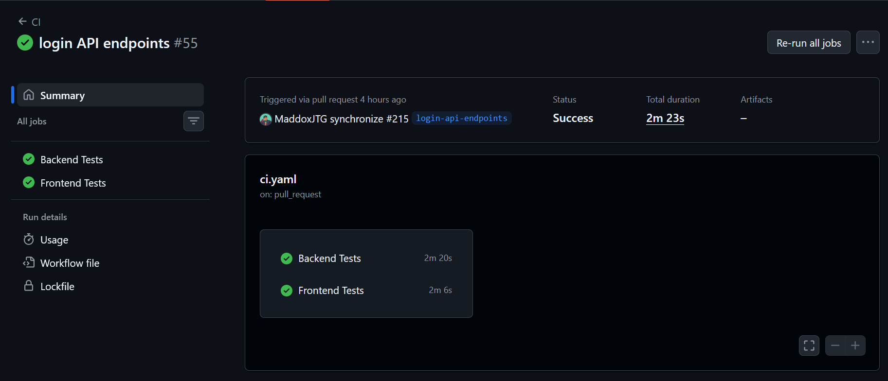
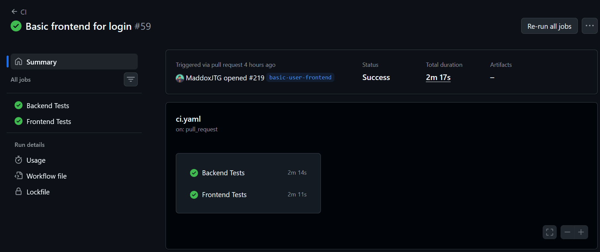

# Individual Log - Week 8

## **For PR #215: Login API Endpoints** https://github.com/COSC-499-W2026/capstone-project-team-9/pull/215

### Implementation
As part of the user login requirements, a user needs to be able to log in using their registered email address and password. The system must validate the login request, authenticate the user's credentials against the database, and return the user's information if authentication succeeds. If the credentials are invalid, the system must return an appropriate error without exposing sensitive information.

Therefore, I implemented the following functionality:
- Added src/schemas/login_schema.py to validate login requests. The schema requires a valid email address and a non-empty password.
- Added src/services/login_service.py to authenticate users by email and verify passwords using the existing verify_password() function from user_service.py.
- Normalized email addresses to lowercase before searching for users, allowing users to log in regardless of the capitalization of their email address.
- Added src/routers/login_router.py with a POST /login endpoint that accepts login credentials and returns the user's name and email when authentication succeeds.
- Configured the login endpoint to return HTTP 401 Unauthorized with a generic error message when the email address is not registered or the password is incorrect.
- Registered the login router in src/main.py so the endpoint is available through the main FastAPI application.
- Added test_login_service.py to test successful authentication, incorrect passwords, unknown email addresses, and email normalization.
- Added test_login_router.py to test successful login responses, invalid credentials, and request validation.
- Used an in-memory SQLite database for testing so the authentication tests do not modify the development database.

### Verification and problem-solving

When I reviewed login_schema.py, I verified that the request requires an email address in a valid format and a password containing at least one character. These constraints allow FastAPI to reject malformed requests before attempting authentication.

When I reviewed login_service.py, I verified that the service normalizes the email address before looking up the user and uses the existing password-verification function rather than implementing a second password-checking mechanism. The service returns None when the email address is not found or the password does not match, allowing the router to handle both cases consistently.

When I reviewed login_router.py, I verified that successful authentication returns a UserResponse containing only the user's name and email. Passwords and password hashes are not included in the response. Invalid credentials result in HTTP 401 Unauthorized with the message "Invalid email or password.", avoiding unnecessary disclosure of whether a particular email address is registered.

When I reviewed the integration in main.py, I verified that the login router is imported and registered using app.include_router(login_router.router). This connects the new endpoint to the existing FastAPI application.

### Engineering Practices

The PR does not contain any temporary workaround because it reuses the existing user repository and password-verification functionality. Authentication is implemented through separate schema, service, and router modules, keeping request validation, business logic, and HTTP handling independent, though our authentication will likely be changed and improved soon.

The functions are relatively small and focused:
- authenticate_user() handles email normalization, user lookup, and password verification.
- login() handles the HTTP request, calls the authentication service, and returns either the user response or an appropriate error.

The implementation also avoids introducing unnecessary dependencies or duplicating password-verification logic.

I reviewed the implementation for the following potential issues:
- Hardcoded values: The endpoint uses HTTP status constants and a consistent generic error message. The error message is appropriate for the current API design.

Duplicate code:
- Password verification reuses verify_password() from user_service.py.

Dead code:
- The new modules contain code associated with the login functionality.

Unnecessary function calls:
- The service stops authentication when the user is not found, avoiding an unnecessary password check.

Excessive conditional logic:
- The service uses simple checks for a missing user and an incorrect password.

Deep nesting:
- The service uses early returns rather than deeply nested conditions.

High cyclomatic complexity:
- The authentication service has a small number of straightforward decision points.

Unrelated responsibilities:
- Request validation, authentication, and HTTP response handling are separated into their respective modules.

### Architecture impacts

The login functionality is written in the following files because each belongs to a distinct layer of the existing FastAPI backend:
    src/schemas/login_schema.py defines and validates the login request.
    src/services/login_service.py implements the authentication process.
    src/routers/login_router.py exposes the login API endpoint and handles HTTP responses.
    src/main.py registers the router with the application.

The service uses get_user_by_email() from the existing user repository to retrieve registered users and verify_password() from the user service to validate their passwords. This reuses existing functionality instead of introducing a separate authentication implementation.

This work belongs in the application's user authentication data flow. The flow is:
1. The client submits an email address and password to POST /login.
2. The login schema validates the request.
3. The login service normalizes the email and retrieves the corresponding user from the database.
4. The service verifies the supplied password against the stored password hash.
5. The router returns the user's name and email if authentication succeeds, or HTTP 401 Unauthorized if authentication fails.

## Testing Receipts

The functionality is covered by the following happy-path tests:
- test_authenticate_user_success verifies that valid credentials authenticate the correct user.
- test_login_success verifies that the endpoint returns HTTP 200 and the expected user information.

The tests also cover abnormal authentication outcomes:
- test_authenticate_user_wrong_password verifies that an incorrect password does not authenticate the user.
- test_authenticate_user_email_not_found verifies that an unregistered email address does not authenticate.
- test_authenticate_user_normalizes_email verifies that an email address written in uppercase can authenticate the corresponding user.
- test_login_wrong_password verifies that an incorrect password produces HTTP 401 Unauthorized.
- test_login_unknown_email verifies that an unknown email address produces the same HTTP 401 response.

I also included negative tests for request validation:
- test_login_invalid_email_format verifies that an invalid email address produces HTTP 422 Unprocessable Entity.
- test_login_missing_password verifies that a missing password produces HTTP 422.
- test_login_missing_email verifies that a missing email address produces HTTP 422.
- test_login_empty_password verifies that an empty password produces HTTP 422.

Among these tests, the service tests are unit-level tests of the authentication logic using a database session, while the router tests exercise the endpoint through FastAPI's TestClient. The router tests therefore provide integration-level coverage of request validation, authentication, and HTTP response handling.

The tests use an in-memory SQLite database so that test users and authentication operations do not modify the development database.

These tests are included in:
    tests/test_login_service.py
    tests/test_login_router.py

This PR does not break anything else in the system because our regression tests workflow passed before merge.

## **For PR #219: Basic Frontend for Login** https://github.com/COSC-499-W2026/capstone-project-team-9/pull/219

### What I did

As part of the user login requirements, users need a frontend interface where they can enter their registered email address and password to log in. The interface must send the credentials to the backend login endpoint, display a success message when authentication succeeds, and inform the user when login fails.

Therefore, I implemented the following functionality:
- Created src/views/LoginView.vue to provide a login form with email and password fields.
- Connected the login form to the backend POST /login endpoint using the existing API client in src/api/client.js.
- Added a success message that welcomes the user by name after a successful login.
- Added an error message that informs the user when authentication fails.
- Used Vue's reactive ref() functionality to manage the email, password, and feedback message.
- Added a /login route to src/router/index.js so users can navigate directly to the login page.
- Added a Login navigation link to src/App.vue so users can access the login page from the application interface.
- Created LoginView.test.js to test form rendering, request submission, successful login, and failed login.
- Added tests/frontend/api/login.test.js to test the API client's GET and POST requests, JSON request handling, and HTTP error handling.

### Verification and problem-solving

When I reviewed LoginView.vue, I verified that the form contains separate email and password inputs and a submit button. The email field uses type="email", while the password field uses type="password". Both fields are marked as required, providing basic browser-side validation.

When I reviewed the form submission logic, I verified that the form uses @submit.prevent="login" to prevent a normal browser form submission. The login() function clears the previous message, sends the credentials through the existing API client's post() function, and displays a welcome message containing the user's name when the request succeeds.

When I reviewed the error-handling logic, I verified that a rejected login request displays a generic failure message. This provides feedback to the user without displaying raw backend errors or exposing unnecessary implementation details.

When I reviewed src/router/index.js, I verified that the login page is registered at /login. I also verified that src/App.vue includes a Login navigation link, making the page accessible through the application interface.

When I reviewed tests/frontend/api/login.test.js, I verified that the tests mock fetch() rather than making real HTTP requests. This allows the tests to check the API client's request configuration and error handling without requiring a running backend.

### Engineering Practices

The PR does not contain any temporary workaround because the login page uses the existing Vue frontend, router, and API client rather than introducing a separate mechanism for making backend requests.

The implementation separates responsibilities between the view, router, and API client:
- LoginView.vue handles form input, submission, and user feedback.
- src/router/index.js defines the route for the login page.
- src/App.vue provides navigation to the login page.
- src/api/client.js handles HTTP requests to the backend.

The main login function is small and focused on submitting credentials and displaying the result. The implementation also uses Vue's reactive state management instead of manually manipulating DOM elements.

I reviewed the implementation for the following potential issues:

Hardcoded values:
- The endpoint path and user-facing messages are explicitly defined for the login functionality. The endpoint path is consistent with the backend API.

Duplicate code:
- The login view reuses the existing API client rather than implementing its own fetch() logic.

Dead code:
- The new view, route, navigation link, and tests are directly related to the login functionality.

Unnecessary function calls:
- The view makes a single API request when the form is submitted.

Excessive conditional logic:
- The login function uses a straightforward try/catch structure to handle success and failure.

High cyclomatic complexity:
- The login function has a simple control flow with success and error handling.

Unrelated responsibilities:
- Form handling, navigation, and HTTP request handling remain in separate files.

### Architecture impacts

The frontend login functionality is written in the following files because each serves a distinct purpose in the Vue application:
    src/views/LoginView.vue contains the login interface and submission logic.
    src/router/index.js registers the /login route.
    src/App.vue adds the Login navigation link.
    src/api/client.js provides the shared HTTP client used to communicate with the backend.
    tests/frontend/views/LoginView.test.js tests the login view.
    tests/frontend/api/login.test.js tests the API client.

This work belongs in the frontend user interaction flow because it allows users to initiate authentication through the application's interface.

The login data flow is:
1. The user navigates to /login.
2. The login form collects the user's email address and password.
3. The user submits the form.
4. LoginView.vue calls post('/login', ...) through the shared API client.
5. The API client sends the request to the backend.
6. The backend validates the credentials and returns either the user's information or an error response.
7. The frontend displays a welcome message or a login failure message based on the result.

The current implementation provides login feedback but does not establish a persistent authenticated session or manage authentication tokens. Those features would need to be implemented separately if required by the application's authentication design.

## Testing Receipts

The frontend login functionality is covered by the following happy-path tests:
- The login view test verifies that the login form renders with the expected heading, email input, password input, and submit button.
- The form submission test verifies that the email address and password are passed to post('/login', ...).
- The successful login test verifies that the interface displays a welcome message containing the user's name.
- The API client GET test verifies that a GET request uses the expected /api/users path and headers.
- The API client POST test verifies that a POST request uses the expected /api/login path, JSON headers, and serialized request body.

The tests also cover abnormal situations:
- The failed login test verifies that a rejected authentication request displays the appropriate error message.
- The API client error-handling test verifies that an unsuccessful HTTP response causes the client to reject the request with an error containing the HTTP status code.

These tests use mocked API responses, allowing the frontend to be tested without requiring a running backend or making actual network requests.

The tests are included in:
    tests/frontend/views/LoginView.test.js
    tests/frontend/api/login.test.js

The view tests are component-level tests that verify rendering, user interaction, and feedback. The API client tests are unit tests that verify HTTP request construction and error handling. Together, they provide coverage of the frontend login flow without requiring end-to-end tests for this PR.

This PR does not break anything else in the system because our regression tests workflow passed before merge.

## **For PR #223: Basic Frontend for Registering Users** https://github.com/COSC-499-W2026/capstone-project-team-9/pull/223

### What I did

As part of the user registration requirements, a new user needs to be able to create an account through the application's frontend by providing a username, email address, and password. The system must validate the registration details, submit them to the backend, and inform the user whether registration succeeds or fails.

Therefore, I implemented the following functionality:
- Created app/frontend/src/views/RegisterView.vue to provide a registration form with username, email, and password fields.
- Connected the registration form to the backend POST /users/register endpoint using the existing API client in src/api/client.js.
- Added client-side validation using HTML input attributes to require all fields, enforce username and password minimum lengths, limit the username and email lengths, and validate the email format.
- Added a success message that welcomes the user by name after successful registration.
- Configured the form to clear the username, email, and password fields after successful registration.
- Added error handling for duplicate usernames or email addresses, invalid registration details, and other registration failures.
- Added a /register route to app/frontend/src/router/index.js so users can navigate directly to the registration page.
- Added a Register navigation link to app/frontend/src/app.vue so users can access the registration page from the application interface.
- Created tests/frontend/views/RegisterView.test.js to test form rendering, request submission, successful registration, duplicate username or email errors, and general registration failures.
- Removed a duplicate import statement from tests/frontend/views/LoginView.test.js to keep the existing login test file clean and avoid duplicate declarations.

### Verification and problem-solving

When I reviewed RegisterView.vue, I verified that the registration form contains username, email, and password fields, along with a Register button. The fields use appropriate HTML input types, and the required attributes prevent submission through the browser when required fields are empty.

I also verified the configured input constraints:
- The username must contain at least one character and cannot exceed 100 characters.
- The email field uses type="email" and has a maximum length of 320 characters.
- The password must contain at least eight characters.

These client-side constraints provide immediate feedback and help prevent invalid input from being submitted. The backend must still enforce its own validation because client-side validation can be bypassed.

When I reviewed the registration submission logic, I verified that the register() function sends the username, email, and password to /users/register through the existing API client. On success, the page displays a welcome message containing the registered username and clears the input fields.

When I reviewed the error-handling logic, I verified that the frontend distinguishes between different HTTP error responses:
- HTTP 409 displays a message indicating that the username or email address already exists.
- HTTP 422 displays a message asking the user to check their registration details.
- Other errors display a general registration failure message.

This allows the interface to provide more useful feedback without exposing raw backend error details to the user.

When I reviewed app/frontend/src/router/index.js, I verified that the registration page is registered at /register. I also verified that app/frontend/src/app.vue contains a Register navigation link, allowing users to reach the new page through the application interface.

When I reviewed RegisterView.test.js, I verified that the API client is mocked so the tests can check registration behavior without sending actual HTTP requests or requiring a running backend.

### Engineering Practices

The PR does not contain any temporary workaround because it integrates the registration page with the existing Vue application structure, router, and API client rather than introducing a separate mechanism for handling requests.

The implementation separates responsibilities between the view, router, and API client:
- RegisterView.vue handles form input, submission, validation attributes, and user feedback.
- app/frontend/src/router/index.js defines the registration route.
- app/frontend/src/app.vue provides navigation to the registration page.
- src/api/client.js handles HTTP requests to the backend.

The registration logic is implemented in a small, focused asynchronous function that submits the form and handles success or failure.

I reviewed the implementation for the following potential issues:

Hardcoded values: 
- The endpoint path, input constraints, and user-facing messages are explicitly defined for the registration functionality. The endpoint path matches the existing backend registration API.

Duplicate code: 
- The implementation reuses the existing API client instead of duplicating HTTP request logic.

Dead code: 
- The new view, route, navigation link, and tests are directly related to user registration.

Unnecessary function calls: 
- The registration function makes a single API request when the form is submitted.

Excessive conditional logic: 
- Error handling uses a straightforward conditional structure to distinguish between HTTP 409, HTTP 422, and other failures.

Deep nesting: 
- The implementation avoids deeply nested conditional statements.

High cyclomatic complexity: 
- The registration function has a relatively simple control flow, with a small number of conditions for handling errors.

Unrelated responsibilities: 
- Form handling, navigation, and HTTP request handling remain separated into their respective files.

### Architecture impacts

The registration functionality is written in the following files because each has a distinct responsibility within the existing Vue frontend architecture:
- app/frontend/src/views/RegisterView.vue contains the registration interface and submission logic.
- app/frontend/src/router/index.js registers the /register route.
- app/frontend/src/app.vue adds the Register navigation link.
- tests/frontend/views/RegisterView.test.js contains tests for the registration interface and its behavior.
- tests/frontend/views/LoginView.test.js was updated to remove a duplicate import statement.

The registration page uses the existing API client to communicate with the backend registration endpoint. This maintains consistency with the login frontend and avoids introducing another HTTP request mechanism.

This work belongs in the frontend user registration data flow because it allows users to create accounts through the application's interface.

The registration data flow is:
1. The user navigates to /register.
2. The registration form collects the username, email address, and password.
3. The browser performs basic validation of the required fields and input constraints.
4. The user submits the registration form.
5. RegisterView.vue sends the registration details to POST /users/register through the shared API client.
6. The backend validates the request and attempts to register the user.
7. The frontend displays a welcome message if registration succeeds or an appropriate error message if registration fails.
8. After successful registration, the frontend clears the input fields.

The current implementation provides account registration and user feedback. It does not automatically log the user in after registration, which keeps registration separate from the login process.

## Testing Receipts

The functionality is covered by the following happy-path tests:
- displays the registration form verifies that the registration page renders the expected heading, username input, email input, password input, and Register button.
- submits the registration details verifies that the form sends the username, email, and password to post('/users/register', ...).
- displays a welcome message after successful registration verifies that the interface displays a success message containing the registered user's name.
I also wrote tests to cover abnormal situations involving registration failures:
- displays an error when the username or email already exists verifies that a rejected request with HTTP 409 displays the appropriate duplicate-account message.
- displays an error when registration fails for another reason verifies that a rejected request with HTTP 500 displays the general registration failure message.

These tests cover the primary registration flow, including successful requests and common error responses.

Among these tests, all five are frontend component-level tests. They use Vue Test Utils to mount the registration component, simulate user input and form submission, and verify the resulting behavior. The API client is mocked, so these tests do not make actual network requests.

Integration tests are not required to verify the isolated component behavior covered here because the frontend view and API client interaction are tested using mocked responses. However, an integration test would be useful for verifying the complete registration flow against the actual backend endpoint.

These tests are included in the directory:
    tests/frontend/views/RegisterView.test.js

The existing login test file was also cleaned up by removing its duplicate import statement. This change does not alter the login functionality.

In our Github, it currently shows that our backend tests are failing. We have found, however, that this is not a problem from this PR or branch. It is due to broken CI with PLay Class conversion from a previous merged PR, that is currently being fixed. I will update this recipt once the tests are fixed. [Week 8 PR #223 Tests](./pics/week-8-pr-223-test-fail.png)
